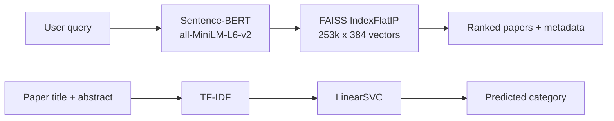

# Research Intelligence Platform

Discover and explore scientific papers with natural-language search and automatic category prediction, built on 253,255 arXiv papers.

> **Status:** ML components complete; Streamlit interface in progress. <!-- update when the app and deployment are done -->

<!--  -->

## Features

- **Semantic search** – describe a topic in plain English (e.g. *"graph neural networks for traffic prediction"*) and get the most relevant papers by meaning, not keyword overlap.
- **Category prediction** – classify a paper's title and abstract into its arXiv category.
- **Similar papers** – explore related work and its metadata (authors, publication date, summary).

## How it works

Two complementary components, each chosen for the job it does best:



| Component | Approach | Purpose |
|---|---|---|
| Semantic retrieval | all-MiniLM-L6-v2 embeddings (384-d) + FAISS exact inner-product search on L2-normalized vectors (equivalent to cosine similarity) | Find papers relevant to a query |
| Classification | TF-IDF + LinearSVC | Predict a paper's research category |

## Dataset

arXiv research papers: **253,255 papers**, 7 columns (`id`, `title`, `category_code`, `published_date`, `authors`, `summary`, `text`). The `text` field (title + summary) is the input for all models; `category_code` is the classification label.

## Classification experiments

I compared several feature representations and classifiers rather than assuming the newest embedding model would win.

| Model | Accuracy |
|---|---|
| **TF-IDF + LinearSVC (selected)** | **78.42%** |
| Sentence-BERT + Logistic Regression | 76.98% |
| Sentence-BERT + LinearSVC | 76.79% |
| TF-IDF + SBERT hybrid | ~77% |
| Word2Vec (mean-pooled) + LinearSVC | ~75% |

**Takeaway:** sparse lexical features won. Technical terms such as *attention*, *convolution*, *retrieval* and *optimization* are highly discriminative for research categories, and dense embeddings did not beat them on this task.

**Error analysis:** the confusion matrix shows the errors concentrate in categories that genuinely overlap: `eess.IV` ↔ `cs.CV`, `stat.ML` ↔ `cs.LG`, `cs.AI` ↔ `cs.LG`, and `cs.IR` ↔ `cs.CL`. Many "mistakes" are close to ambiguous labels rather than clear failures.

> Figures are from my experiments; the hybrid and Word2Vec numbers are approximate. <!-- state your train/test split here, e.g. 80/20 stratified, so the numbers are comparable -->

## Semantic search

Queries tested during development include *graph neural networks for traffic prediction*, *large language models*, *quantum computing* and *image segmentation*, with relevant results returned for each. <!-- optionally add a small table of 2-3 example queries and their top results -->

`IndexFlatIP` performs exact search, which is a sensible baseline at this scale. Approximate indexes (IVF, HNSW) are a possible future optimization.

## Project structure

```
ResearchIntelligencePlatform/
├── data/          # processed dataset and embeddings (not tracked in git)
├── notebooks/     # experiments: classification, embeddings, FAISS
├── reports/       # evaluation outputs
├── srcs/          # application and backend code
└── requirements.txt
```

## Setup

```bash
git clone https://github.com/atharva-29d/ResearchIntelligencePlatform.git
cd ResearchIntelligencePlatform
python -m venv .venv
source .venv/bin/activate        # Windows: .venv\Scripts\activate
pip install -r requirements.txt
```

**Data and artifacts.** Place `processed_arxiv.pkl` and `sentence_embeddings2.npy` in `data/`. <!-- add a download link or instructions for obtaining them -->

**Build the index and classifier once:**

```bash
python srcs/backend.py build
```

**Run the app:**

```bash
streamlit run srcs/app.py
```

## Tech stack

Python · scikit-learn · Sentence-Transformers · FAISS · Gensim · pandas · NumPy · Streamlit

## Roadmap

- [x] Dataset preprocessing and text preparation
- [x] Classification experiments (TF-IDF, Word2Vec, SBERT, hybrid)
- [x] Full-dataset Sentence-BERT embeddings
- [x] FAISS semantic search
- [ ] Reusable backend and saved artifacts
- [ ] Streamlit interface
- [ ] Testing and deployment

## Limitations

- Category labels overlap heavily in some areas (see error analysis), which caps achievable accuracy.
- Search quality depends on the general-purpose MiniLM model; a scientific-domain embedding model could improve relevance.
- Exact search is fast enough here but will not scale indefinitely.

## Author

Atharva · B.Tech AI & ML, Vishwakarma Institute of Technology, Pune · [GitHub](https://github.com/atharva-29d)
